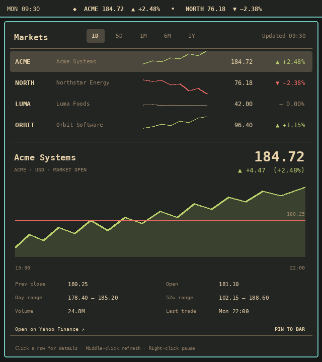
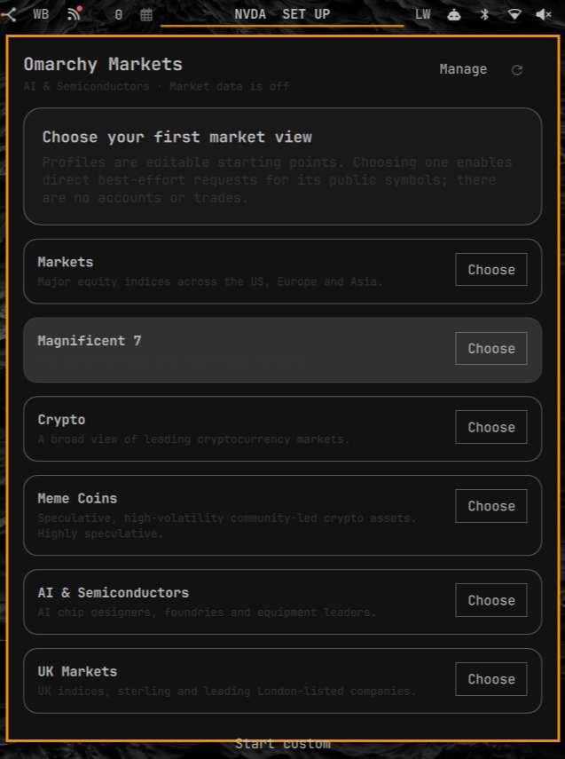

<h1 align="center">Omarchy Markets</h1>

<p align="center">
  <a href="https://github.com/tcballard/omarchy-badges"></a>
</p>

<p align="center">Stocks, indices and crypto. A glance at the bar, a closer look when you need it.</p>

Keep a watchlist moving across your Omarchy bar. Click to compare quotes,
explore price history or pin the instrument you care about. Start with a
profile and make it yours — no account or API key needed.

**v0.5.0 is being prepared.** Named watchlists and chart inspection are on main;
the latest published release is v0.4.0. See the [candidate test guide](docs/releases/v0.5.0-testing.md)
and [v0.5.0 notes](docs/releases/v0.5.0.md) for scope and remaining acceptance.



## Install

Requires **Omarchy 4 / Quattro** with shell-plugin support and **Python 3.10+**.

```bash
omarchy plugin add https://github.com/tcballard/omarchy-markets.git --enable
```

Click the widget and choose a profile to start. Market data stays off until
you choose one or enable your own watchlist.

## Make it your market view

Start with **Markets**, **Magnificent 7**, **Crypto**, **Meme Coins**,
**AI & Semiconductors** or **UK Markets**. Add, remove and reorder symbols,
then choose which one stays pinned in the bar. Profiles are editable starting
points; the Meme Coins profile is labelled speculative.

Keep up to eight named watchlists, with changes saved to the active list.
Use **Manage** to create an empty list, save a copy, rename or delete it.
Switch lists above the quotes, then choose saved order, gainers or losers.
Your sort order and chart visibility are remembered after restarting the shell.
Hover over the chart to inspect a sampled price and timestamp, or press **I**
and use the arrow keys. Escape returns to the watchlist controls.

- **Scan:** a scrolling ticker, or a compact single-symbol view.
- **Explore:** five chart ranges, from one day to one year, with key statistics.
- **Keep your place:** inspect another instrument without changing your pin.
- **Slow it down:** pause the ticker, hide prices or turn motion off entirely.

<details>
<summary>See the profile chooser</summary>



</details>

Left-click opens the panel. Middle-click refreshes. Right-click pauses the
ticker. Inside the panel, use the mouse or arrow keys; **Escape** closes it.
The [full controls and settings](docs/reference.md#use) are there when you need them.

## About the data

Quotes come from Yahoo Finance's unofficial endpoint and may be delayed or
unavailable. Last-known values are labelled when stale. This is an
informational market view, with no trading or portfolio tools.

The main preview shows v0.4.0 running on Tom’s XPS; the profile chooser
capture is from v0.3.2. See the [capture records](docs/acceptance.md) for
their source and the [changelog](CHANGELOG.md) for changes.

## Update or remove

```bash
omarchy plugin update io.github.tcballard.omarchy-markets
```

```bash
omarchy plugin remove io.github.tcballard.omarchy-markets
```

Removal stops polling. Optional cached quotes can be cleared separately;
see [cache details](docs/reference.md#data-cache-and-privacy).

[Marketplace](https://plugins.omarchy.org/plugin.html?id=io.github.tcballard.omarchy-markets)
· [Releases](https://github.com/tcballard/omarchy-markets/releases)
· [Report an issue](https://github.com/tcballard/omarchy-markets/issues)
· [Reference](docs/reference.md)
· [Security](SECURITY.md)
· [Development and release checks](docs/releasing.md)

Inspired by the scan-first interaction in
[omarchy-stocks](https://github.com/5d0tal1gat0r/omarchy-stocks).
Independent community plugin. [MIT](LICENSE) © 2026 Tom Ballard.
